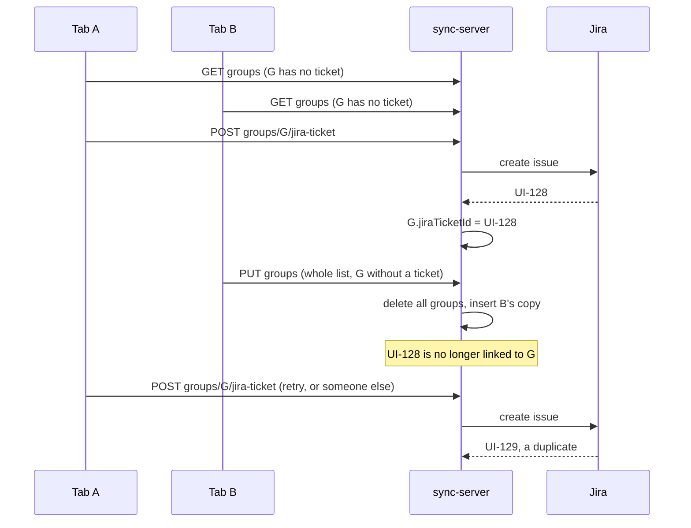

# ADR-0019 Write comments and groups one item at a time

## Context and Problem Statement

Every change a client makes to its comments or groups is saved by sending **the whole list**: `PUT /workspaces/{id}/comments` and `PUT /workspaces/{id}/groups`, each with every item the client holds. The server answers both by deleting every row of that workspace and inserting the client's copy (`D1SyncRepository.persistComments`, `persistGroups`). There are 17 call sites in `packages/react-grab` that trigger these writes.

Clients load comments and groups **once, at start-up**, and never refresh. So every open tab holds a copy that is stale from the moment anyone else writes, and its next save replaces the server's state with that stale copy. This is the lost update problem: a write silently undoes writes it never saw.

It is invisible with one person on a workspace and certain with two. Two concrete outcomes:

**A comment disappears.** A and B both have the workspace open. A adds a comment. B, holding a list without it, adds their own; B's save deletes A's.

**A ticket link disappears, and the next create duplicates the ticket.** `createTicketFromGroup` writes the new ticket key onto the group server-side (`updateGroupJira` sets `jiraTicketId` and `status: "ticketed"`). Any other client whose group list predates that ticket overwrites the group without it on its next group save. The idempotency guard in `createTicketFromGroup` checks `jiraTicketId` to avoid creating a second ticket — with the key wiped, the guard passes and Jira gets a duplicate.

## Decision Drivers

- Least ongoing maintenance: no merge algorithm and no retry loop to own.
- Fits the existing Zod → OpenAPI → Orval chain, so new routes produce a typed client rather than hand-written fetch code.
- Server-originated facts (the ticket key and the `ticketed` status) must not be writable by a client that did not produce them.

## Considered Options

### Option A — one resource per item, adopted

Make each comment and each group its own HTTP resource:

| Method | Path | Meaning |
|---|---|---|
| `PUT` | `/workspaces/{id}/comments/{commentId}` | create or replace one comment |
| `DELETE` | `/workspaces/{id}/comments/{commentId}` | remove one comment |
| `PUT` | `/workspaces/{id}/groups/{groupId}` | create or replace one group |
| `DELETE` | `/workspaces/{id}/groups/{groupId}` | remove one group |

The whole-list `PUT` routes are removed.

This is standard HTTP semantics rather than a mechanism of our own: `PUT` replaces the state of its *target resource* (RFC 9110 §9.3.4). Today the target is the whole workspace, so a `PUT` replaces the whole workspace; with this change the target is one item, so a write can only replace that item. Two people editing *different* comments can no longer affect each other, which is the case that happens in practice.

`jiraTicketId` and `status` become read-only in the group write schema. The server already sets them; the client stops sending them.

Deleting a synthetic group — the reason `persistGroups` was made full-replace, per its own comment — becomes an explicit `DELETE` of that group instead of an omission from a list.

### Option B — keep whole-list writes, guard them with `If-Match`

Give each workspace's list a version (an ETag); the client sends it in `If-Match`, and the server answers `412 Precondition Failed` when the list changed underneath. This is the textbook guard against lost updates ([MDN, If-Match](https://developer.mozilla.org/en-US/docs/Web/HTTP/Reference/Headers/If-Match); RFC 9110 §13.1.1).

Rejected as the primary fix because it moves the problem rather than removing it. Every rejected save needs the client to refetch, merge its change into the fresh list, and retry — and the merge is exactly the custom logic we want to avoid owning. With 17 call sites writing whole lists, two active users would trade 412s on most saves.

It remains the right tool for the narrower case Option A leaves open (below).

### Option C — a real-time sync engine

Durable Objects, a CRDT, or a hosted sync service would also give each tab live updates from others. Rejected as out of proportion to a developer overlay whose current problem is that writes clobber each other, not that tabs lack live presence.

## Decision

Option A.

## Consequences

**Good.** Edits to different items never conflict. The duplicate-ticket path closes, because no client can write `jiraTicketId`. Writes get smaller: one item instead of the workspace. The fix is ordinary REST, generated into typed clients for `react-grab` and `dashboard` by the existing codegen.

**Still open: two people editing the *same* item.** The last write to that item wins. Comments are single-author, so this needs two people editing one person's comment at once; group renames are rare. If it starts to happen, add `If-Match` per item with a version column — Option B at item scope, where the client's recovery is "reload this one item", not a merge.

**Still open: tabs do not see each other's changes** until reload, because data is loaded once at start-up. Per-item writes stop that staleness from destroying data; showing other people's changes live is separate work.

**Cost.** A breaking change to the sync API. The client's `StorageAdapter` moved from `persistComments(all)` / `persistGroups(all)` to `upsertComment`, `deleteComment`, `upsertGroup` and `deleteGroup`. Because the only consumer runs the client and the Worker from this repository, both ship together. The deployed Worker (31 March build, no secrets set) is not in use and must be redeployed before any client that depends on the new routes.

## Implementation notes

**The 17 call sites did not change.** They all go through `syncLayer.persistComments(next)` / `persistGroups(next)`, which still take the whole next list — that is the local state. The sync layer now compares it with this client's own previous state (`features/sync/business/item-changes.ts`) and sends only what differs, one request per item. The comparison runs before the store is updated, and only over the fields the server stores (`toCommentWire`, `toGroupWire` in `transforms.ts`), so a local-only change such as preview bounds sends nothing. Because both lists are this client's own view, the result can never include an item someone else added.

**Ticket fields are enforced three times.** The generated `UpsertGroupBody` type has no `jiraTicketId` or `status`, so the client cannot send them; the server schema `SelectionGroupWrite` strips them if sent anyway; and `upsertGroup` in the repository writes only client-owned columns.

**A related bug fixed on the way.** When revealed state is not synced it is kept in localStorage, and the old adapter saved it as `(comments, [])` on comment writes and `([], groups)` on group writes — each wiping the other's flags. The sync layer now saves both lists together.

## How it is proved

- `packages/sync-server/src/repositories/__tests__/d1.repo.test.ts` runs against real D1 inside workerd (Cloudflare's `@cloudflare/vitest-plugin`, migrations applied per test file). It performs a stale write of comment X and asserts comment Y survives, and creates a ticket on group G, then writes G from a copy without the ticket, and asserts the link survives.
- `packages/sync-server/src/routes/__tests__/item-writes.test.ts` goes through the Worker's own entry point: a body id that does not match the URL is rejected, the whole-list routes answer 404, and forged ticket fields in a group write are ignored.
- `packages/react-grab/e2e/mocked/item-writes.spec.ts` drives the real UI against the mocked server: a new comment is one request, the workspace's existing comments are never written, clearing sends one delete per known comment, and no group write carries ticket fields.

These were written alongside the change rather than first, so none of them was seen failing against the old code: the old whole-list API no longer exists for them to run against.
