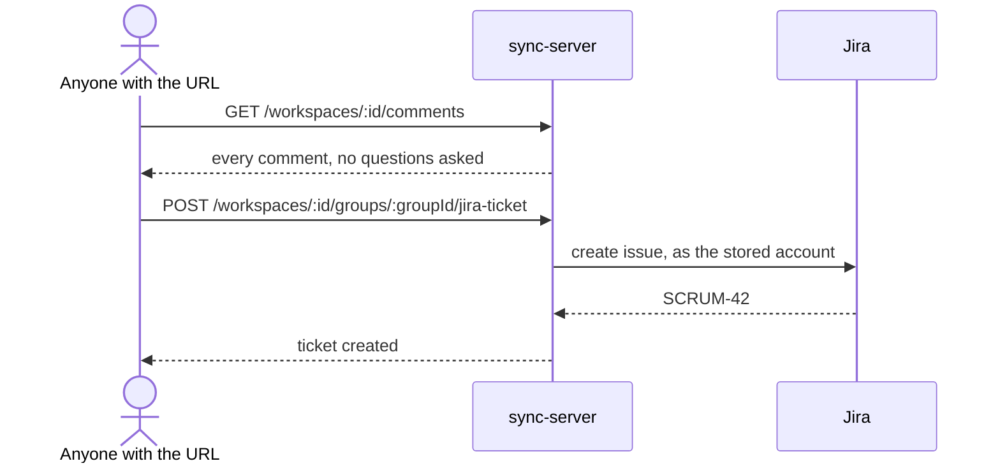
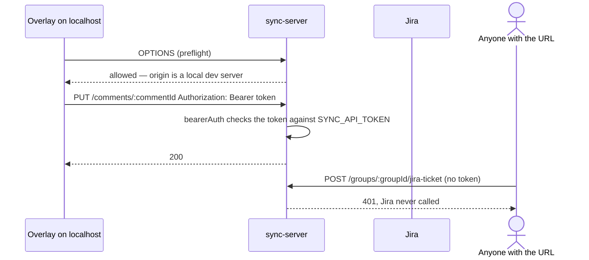

# ADR-0020 Protect the sync server with a bearer token and an origin allowlist

## Context and Problem Statement

`packages/sync-server` has no authentication. Its only middleware injects repositories, and `app.ts` calls `cors()` with no options, which Hono documents as allowing every origin ([Hono CORS](https://hono.dev/docs/middleware/builtin/cors)). Anyone who knows the Worker's URL can read and write every workspace's comments, groups and screenshots.

Until now that was harmless in production only by accident: the deployed Worker has no Jira credentials. We are about to set them. From that moment the same open door also creates Jira tickets on `doruksahin.atlassian.net` as the account whose token we store.

## Who calls the server

The design turns on this, so it is stated precisely:

- **The overlay**, running in a browser inside a host application's page — today AdCreative-Frontend-V2 on a local dev server — and calling the Worker cross-origin. `initSync()` is called only behind `import.meta.env.DEV`, so the overlay and anything it is configured with never ship in a production bundle.
- **The dashboard** (`packages/dashboard`), a local Vite app.
- **`` elements** in both, which load screenshots straight from `GET /workspaces/{id}/screenshots/{commentId}/{kind}`. An `` request cannot carry an `Authorization` header.

Nothing else in this repository calls the server.

## Decision Drivers

- The caller is a browser page on another origin, so every write is a preflighted cross-origin request.
- One mechanism, not two; least ongoing maintenance; built from documented middleware rather than our own.
- The Jira token must never be reachable by a caller we did not hand a credential to.

## Considered Options

### Option A — Cloudflare Access in front of the Worker, rejected

Access is Cloudflare's own way to put a login in front of a Worker, and a Worker behind it can trust `ctx.access` without parsing anything ([Cloudflare Access for Workers](https://developers.cloudflare.com/workers/configuration/cloudflare-access/)). It is the right tool for a person opening the dashboard in a browser tab.

It fits our main caller badly. Cloudflare's own CORS guidance for Access says preflighted requests return `403` even after login, because "the browser never includes cookies with OPTIONS requests, by design"; that simple requests fail until the user has logged in on the protected domain first; and that the `CF_Authorization` cookie can be blocked as a third-party cookie on cross-origin requests ([Access and CORS](https://developers.cloudflare.com/cloudflare-one/access-controls/applications/http-apps/authorization-cookie/cors/)). Every overlay write is a preflighted cross-origin request from someone else's page, so each of those applies.

### Option B — a bearer token checked by Hono's middleware, adopted

The Worker holds one token as a secret (`SYNC_API_TOKEN`, set with `wrangler secret put`). Every API request carries `Authorization: Bearer <token>`, checked by Hono's built-in `bearerAuth` middleware, which supports a per-request `verifyToken` callback that can read the secret from the environment ([Hono bearer auth](https://hono.dev/docs/middleware/builtin/bearer-auth)).

`cors()` is given an origin allowlist instead of `*`, through the same middleware's `origin` option. Local dev servers (`localhost`, `127.0.0.1`) are allowed by default because the overlay only runs in development builds; anything else must be listed in a non-secret `ALLOWED_ORIGINS` var. CORS runs before the token check, so preflights succeed without a credential, as the protocol requires.

The overlay gets the token the way it already gets the server URL and workspace: as an `initSync()` option, which the host app fills from its own `.env.local`. Because `initSync()` runs only in development builds, the token is never in a production bundle.

### Option C — per-user sign-in (OAuth or SSO), rejected for now

Gives individual identity and revocation, at the cost of an identity provider, a login flow inside an overlay, and token refresh. Out of proportion for an internal development tool used by a handful of people. The trigger to revisit is below.

## Screenshots

Option B leaves `` requests without a credential. Three ways to close that were weighed:

- **Leave the screenshot route public and treat its URL as a capability.** A capability URL is only safe when it is unguessable — the W3C TAG guidance on capability URLs expects a cryptographically random component. Our ids are `prefix-<timestamp>-<7 chars of Math.random()>`, which is neither. Rejected.
- **Signed URLs.** Cloudflare's official Workers example signs the path and a timestamp with HMAC-SHA256 and verifies with `crypto.subtle.verify` ([Signing requests](https://developers.cloudflare.com/workers/examples/signing-requests/)). It would keep `` working, but it adds a second secret, an expiry policy, and server-generated URLs in the API — and the overlay loads its data once per session, so any expiry shorter than a working day breaks images mid-session.
- **Fetch the image with the same bearer token and display it from a blob URL.** One mechanism for every request, no second secret, nothing expires. Adopted. It is the standard browser technique for authenticated media (`fetch` + `URL.createObjectURL`), wrapped once per app in a small hook used by the components that render screenshots today.

Signed URLs become the better choice if a screenshot ever needs a plain link that works outside the app, such as pasting it somewhere.

## Decision

Option B, with screenshots fetched through the same token.

## Consequences

**Good.** The Jira token is unreachable without the API token. Both checks are stock Hono middleware. One credential covers the overlay, the dashboard and screenshots.

**Bad.** The token is shared: everyone with it can do everything, and it cannot tell people apart. Rotating it means updating the Worker secret and every developer's `.env.local`. It also sits in each developer's local environment, so it is only as private as those machines — acceptable for a development tool, not for anything customer-facing.

## How it was built

- **Server.** `SYNC_API_TOKEN` (32+ characters) and `ALLOWED_ORIGINS` are validated by `parseAuthEnv()` in `schemas/env.ts`, the ADR-0018 pattern; a missing token fails every API request closed. `middleware/access-control.ts` builds Hono's `cors` and `bearerAuth` per request so they can read the environment — the pattern Hono documents for env-dependent options — and `bearerAuth` keeps its own constant-time comparison. `app.ts` applies the token check to `/workspaces/*` and `/jira/*`; `/health`, `/doc` and `/ui` stay public.
- **Overlay.** `initSync({ apiToken })`, required when sync is enabled. The Orval fetch mutator (`generated/custom-fetch.ts`, hand-written) and the adapter's three direct requests send the header. Screenshots load through `useAuthenticatedImageUrl`, used by the two components that render them, which also stay lazy so a long list does not fetch every thumbnail at once.
- **Dashboard — changed from the plan above.** It turned out to reach the server only through its Vite dev proxy, so the proxy adds the header instead (`vite.config.ts`, from a non-`VITE_` `SYNC_API_TOKEN`). That is simpler and safer than sending it from the browser: the token never reaches dashboard browser code, and its `` screenshot requests carry it without any image hook.
- **AdCreative-Frontend-V2**, outside this repository: `VITE_REACT_GRAB_SYNC_TOKEN` in `.env.local`, passed to `initSync({ apiToken })`.

## How it is proved

- `packages/sync-server/src/middleware/__tests__/access-control.test.ts`, in workerd: no token and a wrong token get `401`, the token gets `200`, the ticket and Jira lookup routes are refused without it, `/health` stays public, a preflight from a local dev server is answered without a token, a listed origin is allowed, any other gets no permission, and the wildcard is gone. Run against the previous open `cors()` setup with the gate removed, 8 of these 10 fail; the 2 that pass are the ones that should pass either way.
- `packages/sync-server/src/lib/allowed-origin.test.ts` covers the origin rule, including look-alike hosts.
- `packages/react-grab/e2e/mocked/item-writes.spec.ts` asserts every request the overlay makes — lists, writes, Jira lookups, ticket creation, screenshots — carries the token, and that a screenshot is shown from a blob URL.

**Test isolation from Jira.** While the gate was removed for the red run above, the Jira-lookup test reached `doruksahin.atlassian.net` with the fake test credentials — a read that failed authentication, nothing created. Test bindings now point `JIRA_BASE_URL` at `https://jira.invalid`, which never resolves, so no test can reach a real Jira site again.

**Revisit when** more than one team uses the server, or anyone outside the company does: per-user identity (Option C, or Access for the dashboard) becomes worth its cost.
