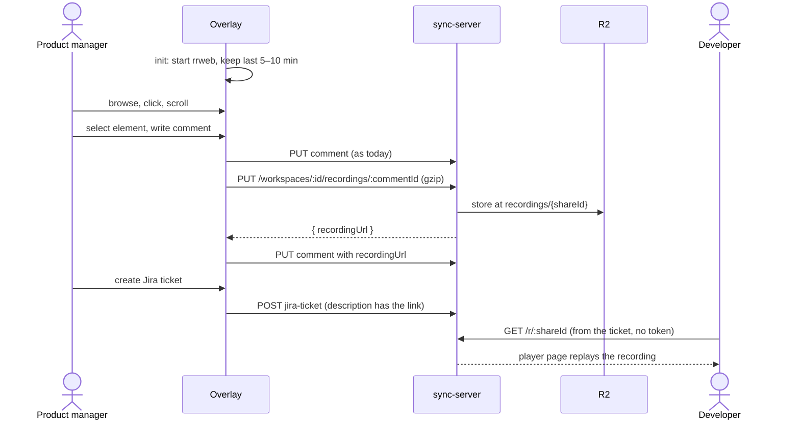

# SPEC-020 Session recording: show how the user got to a selection

## Overview

When recording is enabled, react-grab records the page in the background with rrweb and keeps the last few minutes. Saving a comment stores that window with the comment. The comment card and the Jira ticket both link to a player page that needs no login (ADR-0021).



**Scope boundaries**

- No recording without `options.recording.enabled: true`.
- No player in the overlay bundle: the card links to the Worker's player page.
- No retention or deletion yet; screenshots are not deleted with their comment either, and recordings follow the same rule until both are handled together.
- No change to the screenshot flow.

## Technical Design

### Folder structure

Only what does not exist yet. Storage, upload plumbing, link rendering and the comment-patch step are reused.

```
packages/react-grab/src/
  features/session-recording/
    index.ts                  createSessionRecorder(config) → { saveFor(commentId, adapter), stop }
    business/
      recent-window.ts        two-buffer window driven by rrweb's isCheckout flag (+ test)
      gzip-json.ts            JSON → gzip Blob via CompressionStream (+ test)

packages/sync-server/src/
  routes/recordings.ts        one resource, one file: the upload route and the public share route
  lib/replay-page.ts          the player page's HTML, kept out of the route
drizzle/                      one migration: comments.recording_url
```

### Reused, not rebuilt

| Need | Existing piece | Change |
|---|---|---|
| Store the events in R2 | `ScreenshotStore` (`upload(key, data, type)`, `get(key)`) is already a generic key → blob store | none |
| Upload from the overlay | `StorageAdapter.uploadScreenshot` pattern | add `uploadRecording`, same shape; a raw `fetch` like screenshots, because the generated client JSON-encodes bodies |
| Save the link on the comment | the screenshot block in `core/index.tsx` patches the comment after a best-effort upload | one more call in the same block, same `patchCommentItem` |
| Link in the Jira description | `renderPageLink(url, text)` in `jira-defaults.ts` already escapes a markdown link | rename to `renderMarkdownLink`, call it for the recording line |
| Hide the overlay from the recording | the host already carries `data-react-grab-ignore` | none |
| Option plumbing | `Options.screenshot` → plugin registry | add `RecordingConfig` and `Options.recording` beside them in `src/types.ts`, the SSOT for options |

### Overlay

- **Option.** `recording?: { enabled: boolean; windowMinutes?: number }`, default window 5.
- **Recorder.** `@rrweb/record@2.2.2`, started in `init()` only when enabled:
  - `checkoutEveryNms: windowMinutes * 60_000`; `recent-window.ts` keeps the last two chunks (rrweb guide, Checkout).
  - `recordCanvas: true`, `sampling: { canvas: 2 }`, `dataURLOptions: { type: "image/webp", quality: 0.6 }` (rrweb canvas recipe).
  - `maskAllInputs: true`, `blockSelector: "[data-react-grab-ignore]"`.
- **On comment save.** `saveFor(commentId)` takes the window, gzips it and uploads it; the existing block patches the comment with the returned `recordingUrl`. Best effort, like screenshots.
- **Card.** `selection-card-body.tsx` shows "Watch how we got here ↗" when `recordingUrl` is set. No player in the overlay.
- **Jira.** `- **Recording:** [Watch how we got here](url)` beside the page line.

### Server

- **No new table and no new repository.** The share id is the R2 key: `recordings/{shareId}.json.gz`, where `shareId = crypto.randomUUID()`. Nothing needs to be looked up.
- **`comments.recording_url`.** One nullable column, written by the client like the screenshot keys.
- **`PUT /workspaces/{id}/recordings/{commentId}`** (token, as every `/workspaces` route): creates the share id, stores the body through `ScreenshotStore`, returns `{ recordingUrl }`.
- **`GET /r/{shareId}`** (public, ADR-0021): without `?events` it returns a fixed HTML page that loads `rrweb-player@2.2.2` from jsDelivr with a pinned version; with `?events` it returns the gzip object with `Content-Encoding: gzip`. One route, two representations of one resource. Both send `Referrer-Policy: no-referrer` and `X-Robots-Tag: noindex`; an unknown id returns 404.
- **Contract.** Zod schemas → `export-spec` → Orval codegen, as for every route.

## Testing Strategy

**Unit (Vitest)**
- `recent-window`: after two checkouts, the window starts with a full snapshot and drops older chunks.
- `gzip-json`: round-trips through `DecompressionStream`.

**Server (workerd, real D1 + R2)**
- Upload without a token → 401; with a token → 200 and a `recordingUrl`.
- `GET /r/{shareId}` with no token → 200 HTML with the no-referrer and noindex headers.
- `GET /r/{shareId}?events` returns the uploaded bytes; an unknown id → 404.

**E2E (Playwright, mocked server, `@SPEC-020`)**
- With recording enabled, saving a comment uploads a recording and the card shows the link.
- With recording disabled, no recording request is made.
- The Jira create request's description contains the recording link.
- A failed recording upload still saves the comment.

### Acceptance criteria

- **AC-1** With `recording.enabled`, saving a comment stores a recording that starts no later than five minutes before the save, or at react-grab's start if that is later.
- **AC-2** The comment card shows "Watch how we got here ↗", which opens the player page and replays the recording. A canvas shows as its snapshot image; canvas animation is not replayed, because that needs rrweb's `UNSAFE_replayCanvas`, which lets the replay frame run scripts with the page's origin.
- **AC-3** A Jira ticket created from that comment links to the same page, and the page plays with no login or token.
- **AC-4** Input values appear masked in the replay, and react-grab's own overlay does not appear.
- **AC-5** Without `recording.enabled`, no recorder starts and no recording request is made.
- **AC-6** The overlay bundle grows only by `@rrweb/record`; the size difference is measured and written in the PR. Measured: 73.9 KB minified, 23.1 KB gzipped (esbuild, the import alone). It is included even when recording is off, because the browser build is a single file.
