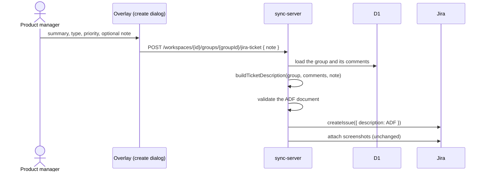

# SPEC-021 Jira ticket description as ADF

## Overview

When a ticket is created, the sync server builds the description as an ADF document from the group's comments in D1 (ADR-0029). The create dialog sends only an optional note that the user writes. The result uses panels, a table, smart links, a collapsed expand and a code block.



## Technical Design

### 1. Shared package `@react-grab/selection-text`

The server needs the same step sentences and file path that the overlay shows. Today they live only in `packages/react-grab`. There is no package that both `react-grab` and `sync-server` import, so this SPEC adds one.

```
packages/selection-text/
  package.json          — name @react-grab/selection-text, private, type module, no runtime dependencies
  src/index.ts          — barrel
  src/describe-step.ts  — moved from react-grab/features/reproduce-steps/business/
  src/recorder-selector.ts — the parse functions describe-step needs, moved with it
  src/extract-file-path.ts — moved from react-grab/features/sidebar/
  src/*.test.ts         — the existing unit tests, moved with their files
```

- The step type in the package is structural: the fields `describeStep` reads (`type`, `url`, `selectors`, `assertedEvents`). Both `ReproduceStep` in the overlay and `ReproduceStepValue` in the server satisfy it, so neither side duplicates the other's type.
- `describeStep` gains one more export, `describeStepParts(step)`, that returns `{ verb, target, targetIsSelector, role, destination }`. `describeStep` becomes a join of these parts, so the sidebar and the step guide do not change. The ADF builder uses the parts to put a CSS selector target in a `code` mark.
- The package is source-only: `exports` points at `src/index.ts`, with no build step (Turborepo calls this a just-in-time internal package). The sources keep `.js` import suffixes so `react-grab`'s `NodeNext` resolution reads them.
- `react-grab` adds it as a `devDependency`, so tsup bundles it (tsup leaves only `dependencies` external) and the published package never names it. `sync-server` adds it as a dependency; Wrangler bundles it for the Worker.
- The old paths in `react-grab` re-export nothing. Every import moves to the package.

### 2. Request contract

`CreateJiraTicketRequest` in `sync-server/src/schemas/jira.ts`:

| Field | Change |
|---|---|
| `note` | New. Optional string, markdown. The user's own text. |
| `description` | Deprecated, optional. Sent only by an overlay or extension built before this SPEC. |

The server decides the description like this:

1. `description` is present and `note` is absent → old client. Convert `description` with `marklassian` and create the ticket as today.
2. Otherwise → build the ADF document (section 3). An empty or missing `note` adds nothing.

After `export-spec`, run `codegen` for `react-grab` and `dashboard`, then `pnpm check:codegen`. Removing `description` is a later change, after the extension store has the new build.

### 3. The builder

New file `sync-server/src/services/jira-ticket-description.ts`, pure, no I/O:

```ts
export const buildTicketDescription = (
  input: TicketDescriptionInput,
): DocNode
```

`TicketDescriptionInput` holds the group name (or `null` for a synthetic group), the group's comments in their saved order, and the note as an ADF fragment (already converted with `marklassian` by the caller). It returns a document built with `@atlaskit/adf-utils/builders`.

Per comment, in this order. A part is left out when its data is missing.

| Part | Node | Source column |
|---|---|---|
| Title | `heading` level 2: `N. ` when there is more than one comment, then `component_name` or `element_name`, then `tag_name` as `code` | `component_name`, `element_name`, `tag_name` |
| Comment | `panel` `note`, one `paragraph` per line | `comment_text` |
| Steps heading | `heading` level 3 "Steps to reproduce", when there are steps or a recording | `steps`, `recording_url` |
| Recording | `panel` `info`: "Watch the recording" with a `link` mark, then "The last 5–10 minutes before this comment." | `recording_url` |
| Steps | `orderedList`, one `listItem` per step from `describeStepParts`; a selector target in `code` | `steps` |
| Where | `heading` level 3 "Where", then a `table` whose first column is a `strong` label: Page (the page title with a `link` mark, or plain text when the URL is not `http(s)`), File (`code`, from `extractFilePath(content)`), Selector (`code`, first of `element_selectors`). A row with no value is left out | `page_url`, `page_title`, `content`, `element_selectors` |
| Agent context | `expand` titled "Context for coding agents", holding `codeBlock` with `language: "html"` and `content` unchanged | `content` |

Around the comments:

- The note fragment comes first.
- A group that is not synthetic adds a `paragraph`: "Group: " + the name in `strong`.
- A `rule` separates two comments.

Text goes into `text` nodes as it is. ADF has no markup inside text, so page text needs no escaping, unlike the markdown template.

A `link` mark is used only for `http:` and `https:` URLs, the same rule as **Open page** (ADR-0024). `inlineCard` is not used: Jira shows a card it cannot resolve as the bare URL, and neither `workers.dev` nor a local page has a resolver.

Comments are ordered by `timestamp`. The note is converted to ADF only when it has text other than spaces.

### 4. Validation

Before `createIssue`, the document goes through `validator()` from `@atlaskit/adf-utils/validator` (`services/adf-validation.ts`). The validator loads `@atlaskit/adf-schema/schema-validator`. If the document fails, the server throws a `JiraError` with code `jira-description-invalid` and status 500, and logs the validator's error. This is a server bug, not a user error.

The validator runs in strict mode **without** an error callback. With a callback, it also reports content candidates that it tries and rejects before it accepts another one: `text` with a `code` mark is first tried as formatted text and reported as an unsupported mark, although the document is valid. Without a callback, it throws only for a real problem.

**Size gate.** Measure the Worker bundle before and after with `wrangler deploy --dry-run --outdir`. If the change adds more than 300 KiB, do not ship the runtime validator: keep the builders, and run the validator in the unit tests only.

Measured on 2026-11-16 (Wrangler's "Total Upload", not minified):

| | Total | gzip |
|---|---|---|
| Before | 2547.28 KiB | 389.66 KiB |
| After | 2672.38 KiB | 408.83 KiB |
| Change | +125.10 KiB | +19.17 KiB |

The bundle has no ProseMirror code. The change is under the gate, so the validator runs at runtime.

### 5. `createTicketFromGroup`

`jira.service.ts` already loads the group's comments. It changes in one place: instead of `markdownToAdf(params.description)`, it calls `buildTicketDescription` (or the old path, section 2). Screenshot attachments do not change. It also loads the group row, which it does not read today: `name` gives the group name, and the `synthetic` column decides whether the "Group:" line is left out.

### 6. Create dialog

`components/sidebar/jira-create-form.tsx`:

- The field label becomes "Note (optional)". It starts empty, on Edit. The Edit | Preview switch stays.
- The data attributes become `jira-note-input`, `jira-note-preview` and `jira-note-hint`.
- Under the field, one line: "The ticket also gets each selection's comment, steps, recording and page."
- The request sends `note`, never `description`.
- `features/jira-ticket/business/default-description.ts` and its test are deleted.

### 7. Docs

- `docs/features/getting-back-to-a-selection.md`, section "Steps on the card": the Jira ticket now shows the steps under "Steps to reproduce" with the recording first.
- `packages/sync-server/CLAUDE.md`, JIRA service: `createTicketFromGroup` builds the description as ADF.
- `architecture.yml`: the new package under `packages.*`, and the `jira-ticket` feature files (`pnpm arch:codegen`).
- ADR-0004: add a line under its decision that ADR-0029 amends it for the ticket description.

## Testing Strategy

### Unit — `sync-server` (vitest in workerd)

New `services/__tests__/jira-ticket-description.test.ts`. Every case runs the output through `validator()` and asserts no error.

| Case | Asserts |
|---|---|
| One comment with every field | Node order: heading, note panel, steps heading, info panel with `inlineCard`, `orderedList`, Where heading, table, expand with `codeBlock` `html` |
| One comment, no steps, no recording | No steps heading, no info panel |
| Recording without steps | Steps heading and info panel, no `orderedList` |
| Steps without recording | Steps heading and list, no info panel |
| Two comments | Numbered titles, one `rule` between them |
| Synthetic group | No "Group:" paragraph |
| Named group | "Group:" paragraph with `strong` name |
| Note given | Note nodes first |
| `page_url` is `javascript:` | Page row is text, not `inlineCard` |
| Comment text with `*`, `[`, `#` | Text nodes hold the characters unchanged |
| CSS selector step | Target has a `code` mark; a named target does not |

### Unit — `@react-grab/selection-text`

The moved tests of `describeStep`, `recorder-selector` and `extractFilePath` pass unchanged from the new place. New cases for `describeStepParts`: navigate, click with ARIA name, click with CSS only, change, click with navigation.

### Service — `sync-server`

There were no route tests for ticket creation, and the existing service tests stub `createTicketFromGroup` itself. `services/__tests__/jira-ticket-create.test.ts` runs `JiraTicketService.createTicket` over real D1 and the real `jira.js` client, with only `fetch` stubbed:

- A request with `note` → `createIssue` gets an ADF document that starts with the note and validates.
- A request with only `description` → `createIssue` gets `markdownToAdf(description)`, as before.

### E2E — `react-grab`

`e2e/mocked/jira-create-dialog.spec.ts`, tagged `@SPEC-021`:

- The field is labelled "Note (optional)" and is empty.
- Submitting sends `note` and no `description` (`mockServer.requests()`).

### Manual

Create one ticket on the real Worker from Cognograph with a selection that has a comment, steps and a recording. Check in Jira that the panels, table, expand and code block render, and that the recording link opens the player.

## Acceptance Criteria

- [x] `packages/selection-text` exists with `describeStep`, `describeStepParts`, the recorder selector parsers and `extractFilePath`
- [x] `react-grab` imports these from `@react-grab/selection-text`; the old files are gone
- [x] The moved unit tests and the new `describeStepParts` tests pass
- [x] `CreateJiraTicketRequest` has optional `note` and deprecated optional `description`
- [x] `openapi.json`, the `react-grab` client and the `dashboard` client are regenerated; `pnpm check:codegen` passes
- [x] `buildTicketDescription` exists in `services/jira-ticket-description.ts` and the 11 unit cases pass
- [x] Every unit case output passes `@atlaskit/adf-utils/validator`
- [x] `createTicketFromGroup` uses `buildTicketDescription`; a request with only `description` keeps the old behaviour; both service tests pass
- [x] Worker bundle size before and after is recorded in this SPEC, and the runtime validator decision follows the size gate
- [x] An invalid document fails with `JiraError` code `jira-description-invalid`
- [x] The create dialog shows "Note (optional)", starts empty, and sends `note`; `jira-create-dialog.spec.ts` passes with the `@SPEC-021` tag
- [x] `default-description.ts` and its test are deleted
- [x] `pnpm typecheck`, `pnpm lint`, `pnpm arch:lint` pass
- [x] Docs updated: `getting-back-to-a-selection.md`, `sync-server/CLAUDE.md`, `architecture.yml`, ADR-0004 note
- [ ] One real ticket checked in Jira; a screenshot of it is attached to the PR

### Deferred (v2)

- [ ] Remove the deprecated `description` field after the extension store has the new build
- [ ] Show a read-only preview of the generated description in the create dialog
- [ ] A component chain row (`iG › iK`) in the Where table; needs the chain stored as its own column
